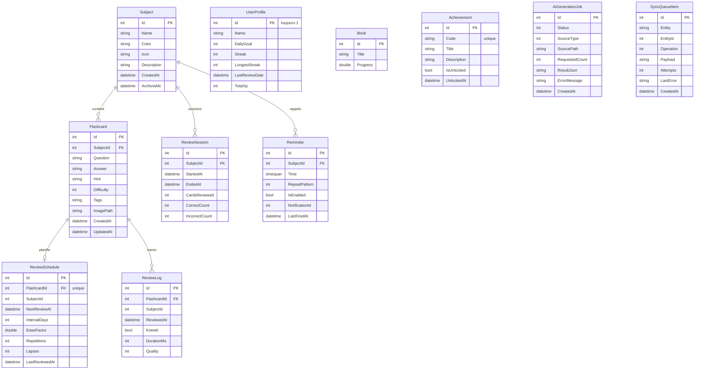
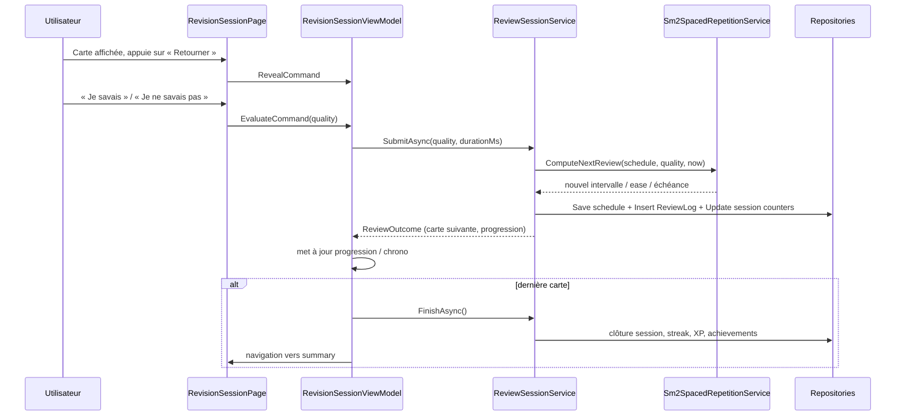
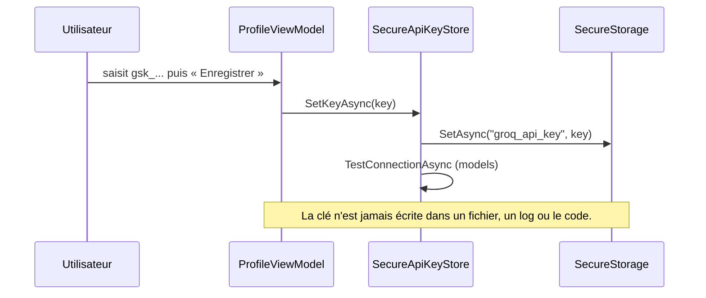
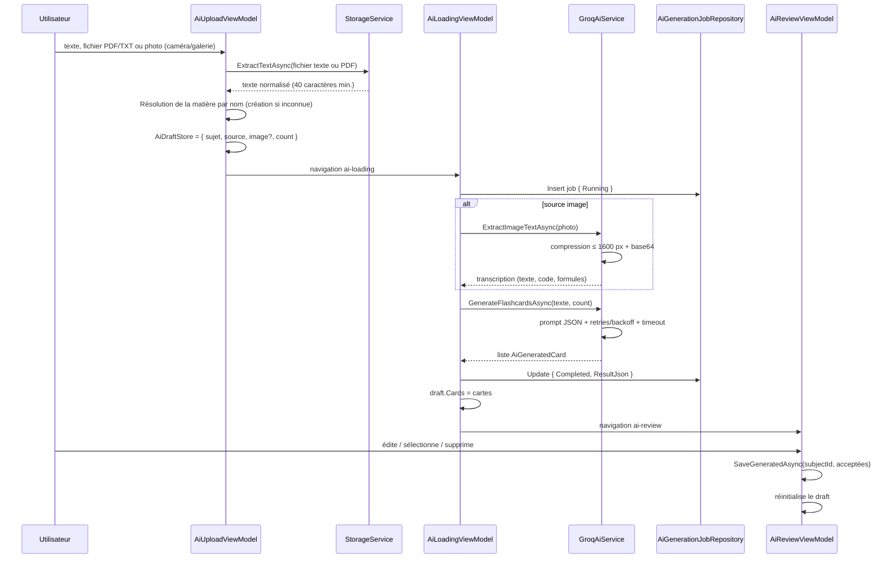
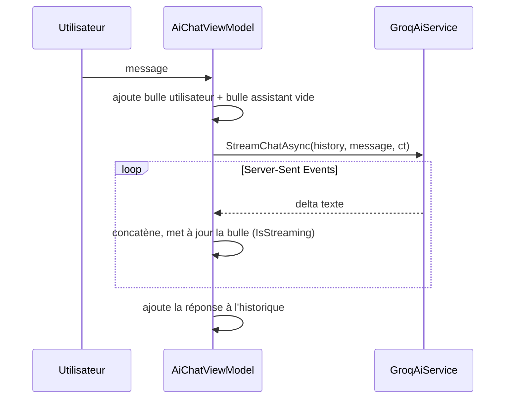
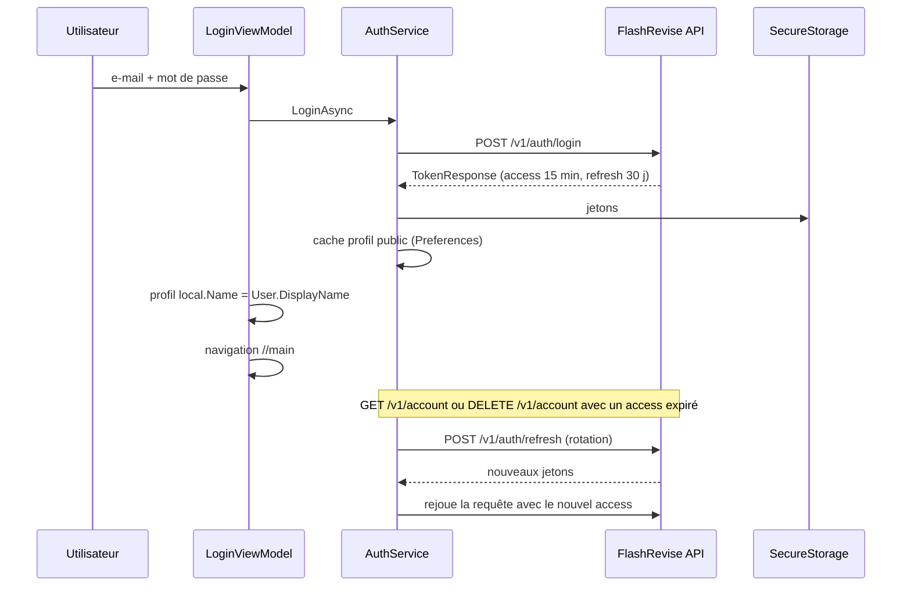

# Architecture — FlashRevise

Ce document décrit l'architecture logicielle, les flux métier critiques et le modèle de données.
Le projet suit une architecture **MVVM en couches** avec injection de dépendances, sans dépendance
d'un ViewModel vers une View (et inversement en dehors du code-behind purement UI).

---

## 1. Vue d'ensemble des couches

```
┌──────────────────────────────────────────────────────────────────────┐
│ Présentation (MAUI XAML)                                             │
│   Views/ (Pages + TabViews)  ──bind──▶  ViewModels/ (MVVM Toolkit)   │
│   Controls/ (RingProgress)   Converters/                             │
└───────────────────────────┬──────────────────────────────────────────┘
                            │ interfaces de services
┌───────────────────────────▼──────────────────────────────────────────┐
│ Domaine / Services métier (Services/)                                │
│   SubjectService  FlashcardService  ReviewSessionService             │
│   Sm2SpacedRepetitionService  StatsService  ReminderService          │
│   NotificationService  OfflineService  SyncService  StorageService   │
│   BookService  DataSeeder  AppBootstrapper                           │
│   Services/Ai/  GroqAiService  SecureApiKeyStore  AiDraftStore       │
│   Services/Auth/  AuthService (API d'authentification, JWT)          │
└───────────────────────────┬──────────────────────────────────────────┘
                            │ interfaces de repositories
┌───────────────────────────▼──────────────────────────────────────────┐
│ Accès aux données (Data/)                                            │
│   FlashReviseDatabase (sqlite-net-pcl)  +  11 repositories           │
└───────────────────────────┬──────────────────────────────────────────┘
                            │ SQLite
┌───────────────────────────▼──────────────────────────────────────────┐
│ Stockage local : flashrevise.db3 (AppDataDirectory)                  │
│ Secrets : SecureStorage (Keystore Android / DPAPI Windows)           │
└──────────────────────────────────────────────────────────────────────┘
```

### Règles de dépendance

- **Views → ViewModels** uniquement par bindings ; le code-behind ne gère que les interactions UI
  impossibles à binder (tap sur une carte, scroll automatique, toast/alerte).
- **ViewModels → Services** via interfaces (`ISubjectService`, `IAiService`, …), jamais vers un repository.
- **Services → Repositories** via interfaces (`IRepositories.cs`), jamais vers `FlashReviseDatabase`.
- **Aucun secret** dans le code, les ressources ou la configuration : seul `SecureApiKeyStore` lit/écrit la clé Groq.

### Injection de dépendances (`MauiProgram.cs`)

| Enregistrement | Durée de vie | Contenu |
| --- | --- | --- |
| Configuration | singleton | `appsettings.json` embarqué (`GroqOptions`, `SyncOptions`) |
| `FlashReviseDatabase` | singleton | connexion SQLite + création des tables |
| Repositories | singleton | 11 repositories |
| Services métier | singleton | SM-2, sessions, stats, rappels, offline, sync, stockage, livres |
| `GroqAiService` | typé `HttpClient` | `BaseAddress` et timeout issus de la configuration |
| `IAuthService` | singleton | client de l'API d'authentification (20 s de timeout, jetons en `SecureStorage`) |
| `SyncService` | `HttpClient` nommé | timeout 30 s |
| ViewModels | transient | un par écran |
| Pages | transient | résolues par `ServiceRouteFactory<TPage>` |

---

## 2. Navigation

- `AppShell` expose une seule `ShellContent` racine (`//main`) : la barre d'onglets est une **TabBar custom**
  dessinée dans `Views/MainTabsPage.xaml` (5 emplacements, FAB central « Réviser »).
- `AppShell.RegisterRoutes()` enregistre chaque route avec `ServiceRouteFactory<TPage>` :
  la page est résolue depuis le conteneur DI (ViewModel injecté au constructeur).
- `Routes.cs` centralise les noms : aucune chaîne magique dans les ViewModels.

| Route | Page | ViewModel |
| --- | --- | --- |
| `splash` | `SplashPage` | — (animation) |
| `onboarding` | `OnboardingPage` | `OnboardingViewModel` |
| `//main` | `MainTabsPage` | onglets : `HomeViewModel`, `SubjectsViewModel`, `StatsViewModel`, `ProfileViewModel` |
| `subject?id=` | `SubjectDetailPage` | `SubjectDetailViewModel` |
| `flashcard?id=` | `FlashcardEditPage` | `FlashcardEditViewModel` |
| `revision-config` | `RevisionConfigPage` | `RevisionConfigViewModel` |
| `revision-session` | `RevisionSessionPage` | `RevisionSessionViewModel` |
| `summary` | `SessionSummaryPage` | `SessionSummaryViewModel` |
| `ai-upload` | `AiUploadPage` | `AiUploadViewModel` |
| `ai-loading` | `AiLoadingPage` | `AiLoadingViewModel` |
| `ai-review` | `AiReviewPage` | `AiReviewViewModel` |
| `ai-chat` | `AiChatPage` | `AiChatViewModel` |
| `schedule?id=` | `ScheduleRevisionPage` | `ScheduleRevisionViewModel` |
| `reminders` | `RemindersPage` | `RemindersViewModel` |
| `subject-stats?id=` | `SubjectStatsPage` | `SubjectStatsViewModel` |
| `goals` | `GoalsBooksPage` | `GoalsBooksViewModel` |
| `achievements` | `AchievementsPage` | `AchievementsViewModel` |
| `offline` | `OfflineStatePage` | `OfflineStateViewModel` |

### Deep link de rappel

Une notification de rappel transporte l'identifiant de matière. Au tap, `NotificationService` déclenche
la navigation vers `revision-config` (matière pré-sélectionnée). Le mécanisme est centralisé dans
`AppShell` pour rester valable quel que soit l'écran d'origine.

---

## 3. Modèle de données (ERD)

Toutes les entités sont persistées via attributs `sqlite-net` (`[PrimaryKey]`, `[AutoIncrement]`, `[Indexed]`).



### Notes de conception

- **Pas de clés étrangères SQL déclarées** : sqlite-net ne les gère pas nativement. L'intégrité est
  garantie par les services (`SubjectService.DeleteAsync` supprime en cascade cartes, échéances,
  logs, rappels dans une transaction).
- `ReviewSchedule.FlashcardId` est **unique** : une échéance par carte, recalculée à chaque réponse.
- `Tags` est une chaîne séparée par des virgules, exposée en lecture par `TagList` (`[Ignore]`).
- `UserProfile` est une ligne unique (`Id = 1`), pattern singleton pour les compteurs globaux.
- `AiGenerationJob` conserve l'historique des générations, y compris les échecs, pour l'écran de chargement.

---

## 4. Flux de révision (SM-2)



### Détail de l'algorithme (`Sm2SpacedRepetitionService`)

| Qualité | Effet |
| --- | --- |
| `DidntKnow` (1–2) | remise à zéro des répétitions, intervalle court, `EaseFactor` réduit, `Lapses++` |
| `Hard` (3) | intervalle minimal, ease légèrement réduit |
| `Good` (4) | intervalle = précédent × ease |
| `Easy` (5) | intervalle = précédent × ease × bonus, ease augmenté |

- `EaseFactor` est borné entre **1.3** et **2.5+**.
- Une carte est **maîtrisée** à partir de **3 rappels réussis** et **21 jours** d'intervalle.
- La qualité est mappée depuis les boutons Know / Didn't know par `MapButton`.

### Effets de bord de fin de session

`FinishAsync()` met à jour, dans une transaction : compteurs de session, `UserProfile.Streak`,
`LongestStreak`, `LastReviewDate`, `TotalXp`, puis évalue les succès. Le résumé est conservé dans
`SessionOutcomeStore` jusqu'à l'affichage de `SessionSummaryPage`.

---

## 5. Flux IA (Groq)

### 5.1 Clé API



`GroqAiService` lit la clé **à chaque appel** ; si elle est absente, il lève `AiNotConfiguredException`,
interceptée par les ViewModels pour afficher l'encart « Configurer la clé API ».

### 5.2 Génération de cartes (Upload → Loading → Review)



- Sources acceptées : texte collé, **PDF** (PdfPig), **photo ou scan** (transcription par le modèle
  vision `Groq:VisionModel`, avec repli sur `VisionFallbackModels`). La photo est redimensionnée à
  1600 px et encodée en base64 avant l'appel ; le modèle de génération reste `Groq:Model`.
- La matière est saisie librement ; un nom inconnu est créé automatiquement (`SubjectService.SaveAsync`).
- Le nombre de cartes est borné (5 / 10 / 15 / 20).
- En cas d'échec, le job passe en `Failed` avec message ; l'écran propose **Réessayer** ou **Retour**.
- Un délai dépassé est distingué d'une annulation utilisateur : la progression s'arrête et l'erreur
  réelle est affichée (le minuteur de progression ne bloque plus sur un faux 90 %).
- L'annulation (`CancellationToken`) interrompt la requête HTTP et marque le job annulé.

### 5.3 Chat tuteur en streaming



- Chaque delta met à jour la propriété observable de la bulle : l'UI se rafraîchit sans re-render complet.
- `Stop` annule le `CancellationTokenSource` ; `Retry` retire la dernière bulle utilisateur et renvoie le prompt.
- Suggestions prédéfinies : mémorisation, quiz, méthode d'apprentissage.

### 5.4 Robustesse réseau (`GroqAiService`)

| Mécanisme | Détail |
| --- | --- |
| Timeout | par requête (`CancellationTokenSource` lié à `TimeoutSeconds`) |
| Retries | `MaxRetries` avec backoff exponentiel, uniquement sur 429 / 5xx / erreurs transitoires |
| Quota | message dédié sur 429 |
| Parsing | extraction JSON tolérante (fences Markdown), validation des champs |
| Streaming | lecture ligne à ligne SSE (`data: ...`), fin sur `[DONE]` |
| Erreurs | exceptions typées : `AiNotConfiguredException`, `AiApiException` (401/429/404), `AiServiceException` (délai, réponse vide, image illisible) |

---

## 6. Authentification (API FlashRevise)

Le compte est **facultatif** : sans session, l'app fonctionne en mode invité avec SQLite local.
La connexion ajoute l'identité serveur ; les cartes restent locales.

### 6.1 Client HTTP

| Élément | Rôle |
| --- | --- |
| `IAuthService` / `AuthService` (`Services/Auth/`) | appels `/v1/auth/*`, `/v1/account`, `/health/live` |
| `AuthException` | message français, `Code` de l'API et code HTTP |
| `SecureStorage` | jetons d'accès (15 min) et de rafraîchissement (30 jours) |
| `Preferences` | cache du profil public (`AuthUser`), adresse de l'API (`AuthBaseUrl`) |
| `AndroidManifest` | `usesCleartextTraffic` pour l'API HTTP de développement |

L'URL de base est résolue dans cet ordre : préférence utilisateur (Profil → Compte) → `Auth:BaseUrl`
de `appsettings.json` → défaut plateforme (`localhost:5047` Windows, `10.0.2.2:5047` émulateur Android).
Aucun secret n'est stocké dans la configuration.

### 6.2 Connexion et rafraîchissement



- Les erreurs serveur (`ProblemDetails.code`) sont traduites en français
  (`invalid_credentials`, `account_locked`, `email_already_used`, `consent_required`, `validation_failed`).
- Un échec réseau ne supprime pas la session : elle est réessayée plus tard. Un 401/400 sur le refresh
  efface les jetons.
- Déconnexion et suppression effacent les jetons et le cache, puis repassent le profil local en invité.

### 6.3 Écrans et navigation

| Route | Écran | Point d'entrée |
| --- | --- | --- |
| `login` | Connexion | accueil invité (chip « Se connecter »), profil, inscription |
| `register` | Création de compte | profil, connexion |
| `forgot-password` | Mot de passe oublié | connexion |

La carte **Compte** du profil expose l'état, l'e-mail, les actions de session et l'adresse du serveur
avec un test `/health/live`.

---

## 7. Mode hors ligne et synchronisation

- **Détection** : `OfflineService` s'appuie sur `Connectivity` et expose `IsOnline`, `OnlineChanged`,
  `PendingSyncCount`, `PendingSyncCountChanged`.
- **File persistée** : chaque mutation hors ligne écrit un `SyncQueueItem`
  (`Entity`, `EntityId`, `Operation`, `Payload` JSON, `Attempts`, `LastError`).
- **Rejeu** : `SyncService.FlushAsync()` vide la file dans l'ordre (FIFO), avec compteur de tentatives ;
  un échec conserve l'élément et enregistre l'erreur.
- **Endpoint absent** (`Sync:Endpoint` vide) : l'app reste 100 % locale, l'écran *Hors ligne* l'indique
  et désactive le bouton de synchronisation.
- **UI** : les écrans affichent un bandeau hors ligne ; les listes se rafraîchissent à la reconnexion
  via les événements (sans polling).

---

## 8. Notifications et rappels

- `ReminderService` persiste le rappel puis délègue la planification à `NotificationService`.
- `Plugin.LocalNotification` planifie une notification **récurrente** (quotidienne ou hebdomadaire).
- `NotificationId` est stocké pour permettre l'annulation lors d'une suppression ou désactivation.
- Au démarrage (`AppBootstrapper`), `RescheduleAllAsync` réarme les rappels actifs : les notifications
  système peuvent être perdues après un redémarrage ou une mise à jour.
- Android : permissions `POST_NOTIFICATIONS`, `RECEIVE_BOOT_COMPLETED`, `SCHEDULE_EXACT_ALARM`
  déclarées dans `Platforms/Android/AndroidManifest.xml` ; la permission runtime est demandée à
  l'activation d'un rappel, et l'utilisateur est averti si elle est refusée.

---

## 9. Thème et design system

| Fichier | Contenu |
| --- | --- |
| `Resources/Styles/Colors.xaml` | couleur par token, déclinées `Light*` / `Dark*` |
| `Resources/Styles/Themes.xaml` | `SolidColorBrush` de surface, hairlines, overlay, textes |
| `Resources/Styles/Styles.xaml` | styles implicites (Label, Entry, Button, Border, Shell…) |
| `Resources/Styles/Icons.xaml` | glyphes Material Symbols (PUA) |

### Contrainte MAUI appliquée partout

Un `SolidColorBrush` ne peut alimenter que des propriétés de type `Brush` (`Background`, `Fill`, `Stroke`).
Toutes les propriétés `Color` utilisent des couleurs inline :

```xml
TextColor="{AppThemeBinding Light={StaticResource LightTextPrimary}, Dark={StaticResource DarkTextPrimary}}"
BackgroundColor="{AppThemeBinding Light={StaticResource LightSurface}, Dark={StaticResource DarkSurface}}"
```

Cette règle a été appliquée systématiquement (81 occurrences corrigées) pour éviter les exceptions
de rendu silencieuses au chargement des pages.

### Adaptation téléphone / PC

- Les pages utilisent `Grid` + `MaximumWidthRequest` et des colonnes adaptatives.
- Les listes passent de 1 à 2–3 colonnes sur grand écran (`OnIdiom` / triggers de largeur).
- La TabBar custom reste ancrée en bas sur téléphone et centrée sur PC.

---

## 10. Conventions de code

- **MVVM strict** : `[ObservableProperty]` en **propriétés partielles** (AOT/WinRT compatible),
  `[RelayCommand]` pour les commandes ; un `RelayCommand` accepte **au plus un paramètre**
  (les actions multi-paramètres sont découpées).
- **Async/await** de bout en bout ; pas de `.Result` / `.Wait()` ; `ConfigureAwait(false)` côté services.
- **Erreurs** : chaque commande capture ses exceptions, alimente `ErrorMessage` et affiche un encart
  visible ; aucun `catch` silencieux.
- **Textes** : aucune chaîne en dur dans le XAML de contenu — ressources ou propriétés de ViewModel.
  Les libellés sont en français.
- **Documentation XML** sur toutes les interfaces de services publiques.
- **Nullabilité** activée (`<Nullable>enable</Nullable>`), aucun avertissement au build.
- **Pas de secret dans le code**, `.gitignore` couvre `bin/`, `obj/`, `*.user`, clés, keystores et certificats.

---

## 11. Décisions techniques notables

| Décision | Raison |
| --- | --- |
| sqlite-net-pcl plutôt qu'EF Core | domaine local simple, démarrage rapide, trimming/AOT sans friction |
| Pile SQLite 3.x fournie par `sqlite-net-pcl` | version patchée, une seule copie de `libe_sqlite3.so`, zéro vulnérabilité connue |
| Propriétés partielles MVVM | compatibilité AOT/WinRT, suppression totale des warnings `MVVMTK0045` |
| TabBar custom plutôt que `TabBar` Shell | FAB central et fidélité stricte aux maquettes Stitch |
| `ServiceRouteFactory` | pages résolues par DI, pas de `new` dans le code-behind |
| `AiDraftStore` singleton | transfère les données entre 3 écrans IA sans paramètres de navigation complexes |
| Configuration embarquée non sensible | le modèle et l'URL Groq sont modifiables sans reconstruire le code métier |
| Clé en `SecureStorage` uniquement | exigence de sécurité explicite du cahier des charges |
